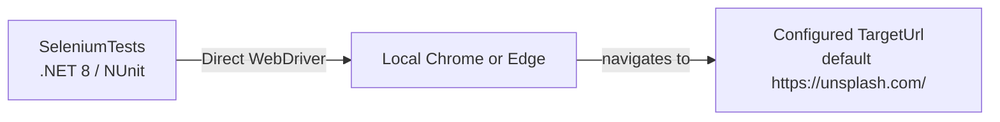

# Azure Debug Plan

> This plan is the source of truth for generating the
> VS Code debug setup in this workspace.
>
> **Status:** Implemented
> **Execution Mode:** Guided
> **Created:** 2026-11-09T14:14:51+07:00
> **Last Updated:** 2026-11-09T15:34:26+07:00
>
> <!-- Guided Mode (default) - hand-holds the user through review and approval before generating. -->
> <!-- Auto Mode (aka YOLO mode) - skips approval gates and runs generation unattended. -->

---

## Prerequisites

| Tool / Extension | Category | Service(s) | Installed | Version |
|------------------|----------|------------|-----------|---------|
| .NET SDK | Runtime | SeleniumTests | ✅ | 8.0.427 |
| Google Chrome | Browser | SeleniumTests | ✅ | 156.0.8078.81 |
| Microsoft Edge | Browser | SeleniumTests | ✅ | 156.0.4314.58 |
| C# extension (`ms-dotnettools.csharp`) | VS Code extension | SeleniumTests | ✅ | 2.160.4 |
| C# Dev Kit (`ms-dotnettools.csdevkit`) | VS Code extension | SeleniumTests | ✅ | 3.40.215 |
| Docker | Container runtime | SeleniumTests | Not required | — |
| Docker Compose | Compose provider | SeleniumTests | Not required | — |

---

## Debug Configurations

| Generate | Debug Config Name | Service Label | Service Root | Project Type | Runtime | Version | Azure Dependencies |
|----------|--------------------|---------------|--------------|--------------|---------|---------|---------------------|
| [x] | SeleniumTests (debug) | SeleniumTests | ./tests/SeleniumTests | background-worker | dotnet | 8.0 | — |

Project Type Descriptions

| Project Type | Description |
|-------------|-------------|
| background-worker | NUnit Selenium test worker, not an HTTP server; tests navigate to a configured target URL. |

> ⚠️ **Compatibility note:** This is a library-style NUnit test project with no standalone executable entry point, and the debug generator has no dedicated `background-worker` recipe. The best-effort F5 configuration starts the categorized UI test and attaches to `testhost.exe`; its task readiness signal was moved to NUnit test discovery after an early signal caused an attach failure. The UI test passes, but direct debugger attachment still needs confirmation in VS Code. Use C# Dev Kit Test Explorer to debug individual tests.

---

## Orchestrator

| Orchestrator | Container Runtime | Compose Command | Description |
|-------------|-------------------|-----------------|-------------|
| Local only | None | — | Use installed local Chrome or Edge. Docker Compose and remote Selenium Chrome are excluded from this debug setup because Docker Desktop cannot be installed in this environment. |

---

## Emulators

| Dependent Service | Emulator | Purpose |
|-------------------|----------|---------|
| — | None | No Azure dependencies or local Azure emulators are required. |

---

## Architecture Diagram

The NUnit worker drives a local browser, which navigates to the configured target URL.

---

## Convenience Scripts

Existing test commands are documented in `README.md`; no additional scripts are selected for generation.

| Generate | Script | Registered In | Description |
|----------|--------|---------------|-------------|

## Debug Configuration Checklist

Debug Configuration Checklist:
❌ SeleniumTests (debug) — `dotnet build` succeeded; the UI test passed 1/1; HTTP verification skipped because this is an NUnit test worker; the earlier F5 attach failed before the readiness-signal fix, and the repaired debugger attachment has not yet been confirmed in VS Code.
